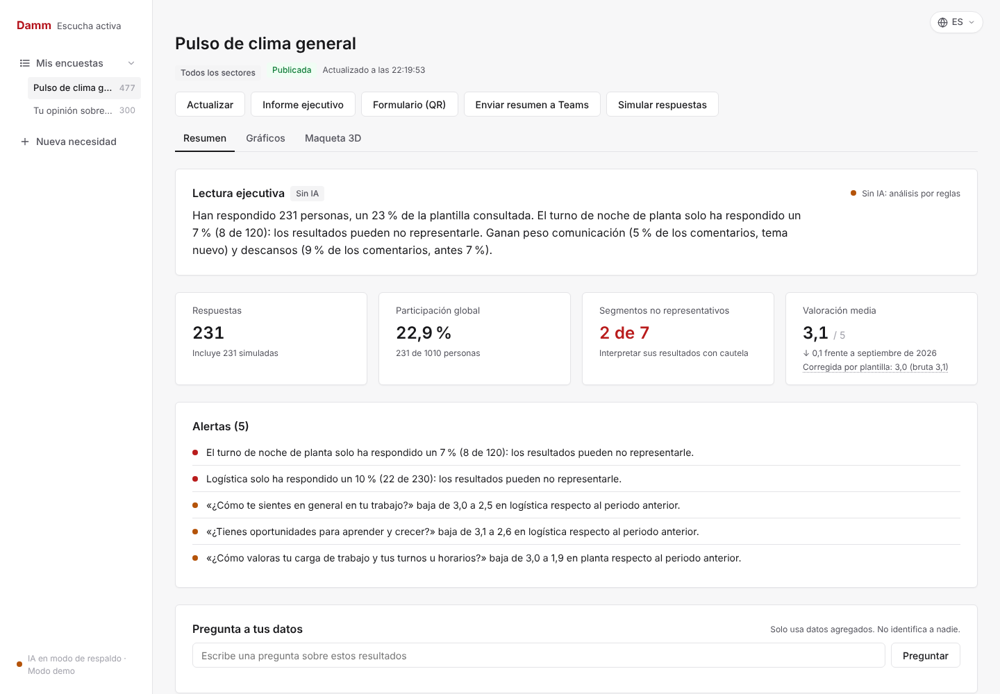
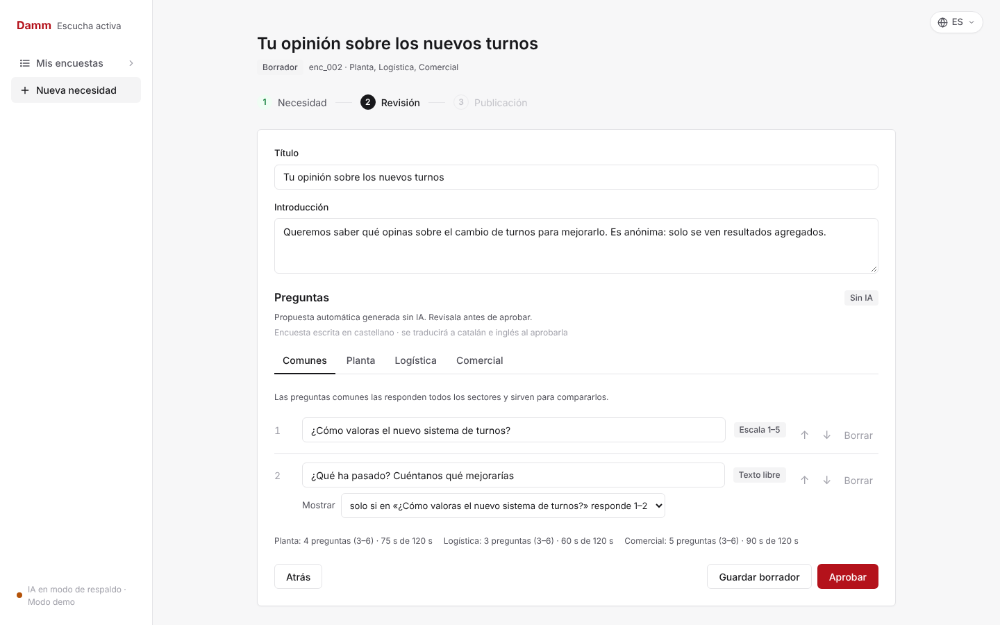
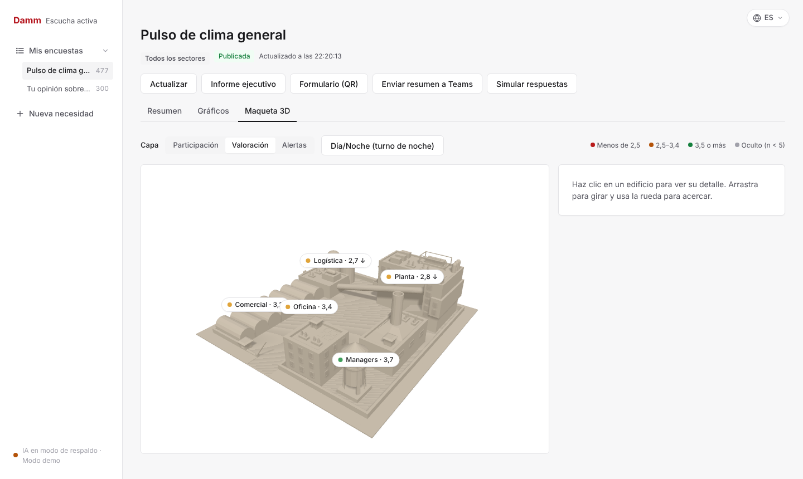
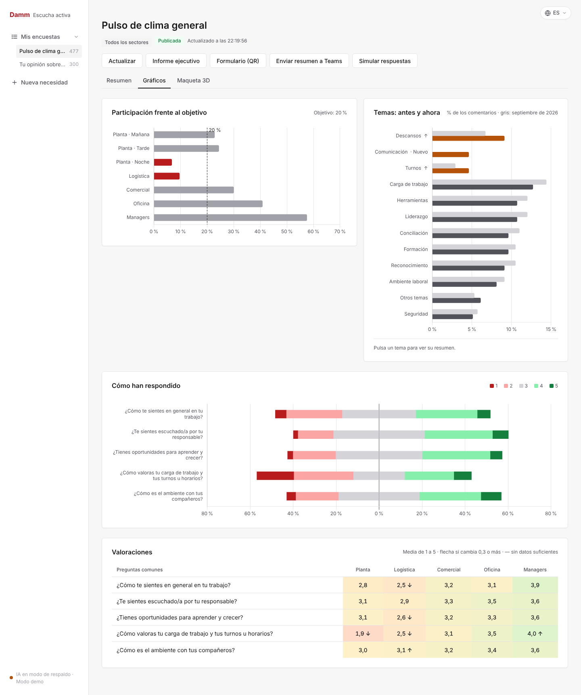
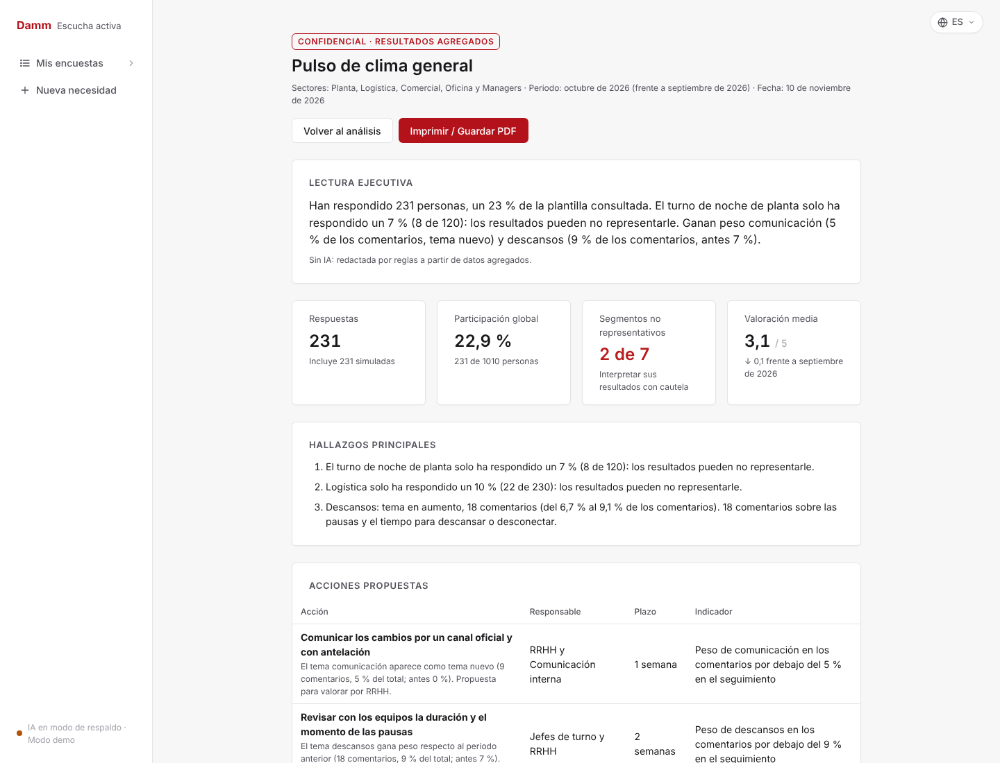
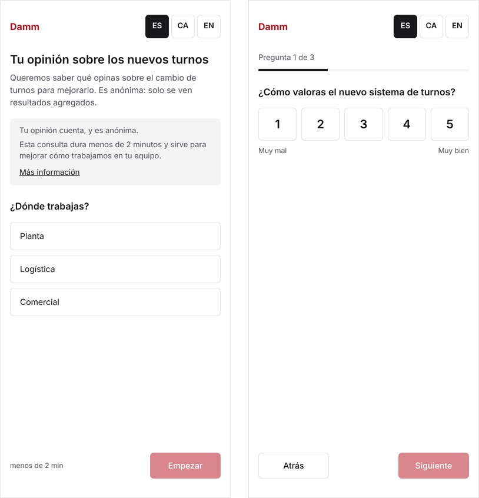

# Escucha activa — escucha a la plantilla con ayuda de IA

[](https://github.com/CarlosMontesMartin/caspersky/actions/workflows/ci.yml)


[](LICENSE)

**RRHH pregunta demasiado, escucha poco y casi nunca enseña qué ha cambiado.** Escucha activa convierte una necesidad de RRHH en una microencuesta adaptada a cada colectivo, recoge respuestas de personas sin cuenta corporativa (planta, logística, comercial) y transforma los resultados en acciones que vuelven a la plantilla: *«Dijisteis → Hemos hecho»*.

Desarrollado en 24 horas en **UAB The Hack 2026** para el reto de Damm y pulido después como implementación de referencia. English: [README.md](README.md).



> Todos los datos del repositorio son **sintéticos**. Es un proyecto de estudiantes, no un producto oficial de Damm.

## Qué aporta

- **IA con validación humana.** Un modelo de lenguaje propone la encuesta, las acciones y los textos de seguimiento. Nada llega a la plantilla sin que RRHH lo revise y lo apruebe.
- **Una encuesta, varios colectivos.** Un núcleo común permite comparar sectores y cada sector recibe preguntas propias, con su vocabulario.
- **Funciona sin IA.** Cada función con modelo tiene un respaldo determinista y la interfaz indica el origen de cada texto. Sin modelo, la clasificación de comentarios acierta el **99 %** (402/406) en los datos sintéticos.
- **Privacidad desde el diseño.** Umbral de anonimato n ≥ 5 con supresión complementaria, para que un grupo oculto no se deduzca restando; anonimización de comentarios en tres idiomas; sin IP, dispositivo ni hora.
- **Rigor estadístico.** Compara la participación con la plantilla real, avisa de los grupos poco representados y ofrece la valoración corregida por el peso de cada colectivo (post-estratificación).
- **Llega a la planta.** Formulario móvil en castellano, catalán e inglés, QR por sector, carteles imprimibles, modo quiosco y tarjetas de Microsoft Teams.
- **Cierra el ciclo.** Las acciones se convierten en compromisos con responsable, plazo e indicador, se comunican a la plantilla y se miden con una encuesta de seguimiento.

## Capturas

| Creación: núcleo común y preguntas por sector | Maqueta 3D con capas de datos |
|---|---|
|  |  |
| **Gráficos por sector y turno** | **Informe ejecutivo (imprimible en PDF)** |
|  |  |

<p align="center"></p>

## Arrancar en local

Requiere **Python 3.10 o superior**. El backend sirve también el frontend.

```bash
git clone https://github.com/CarlosMontesMartin/caspersky.git
cd caspersky
cp .env.example .env     # opcional: clave del modelo, Teams, etc.
./run.sh                 # Windows: run.bat · cualquier sistema: python run.py
```

Abre **http://localhost:8000**. La documentación interactiva de la API está en `/docs`. Variables de entorno, acceso desde el móvil y problemas frecuentes: [docs/configuracion.md](docs/configuracion.md).

## Pruebas

```bash
python -m pytest                       # almacén, métricas y anonimización
python -m backend.api.probar_ciclo     # ciclo completo por la API
python -m backend.ia.probar_generar    # robustez de la generación
python -m backend.ia.probar_analizar   # precisión de la clasificación (es / ca / en)
python scripts/comprobar_i18n.py       # todos los textos existen en los tres idiomas
```

Se ejecutan en CI en cada push, sin clave de IA.

## Documentación

[Arquitectura](docs/arquitectura.md) · [API](docs/api.md) · [Configuración](docs/configuracion.md) · [Decisiones técnicas](docs/decisiones.md) · [Privacidad](docs/privacidad.md) · [Diseño de la interfaz](docs/diseno.md) · [Material de la presentación](docs/presentacion/)

## Licencia

[MIT](LICENSE). Las librerías de `frontend/vendor/` conservan sus propias licencias.
