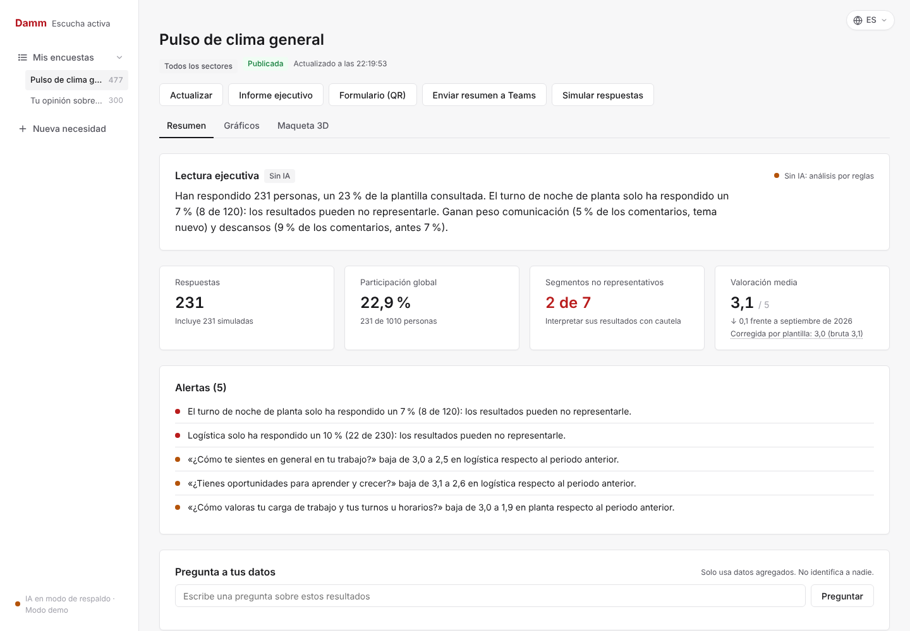
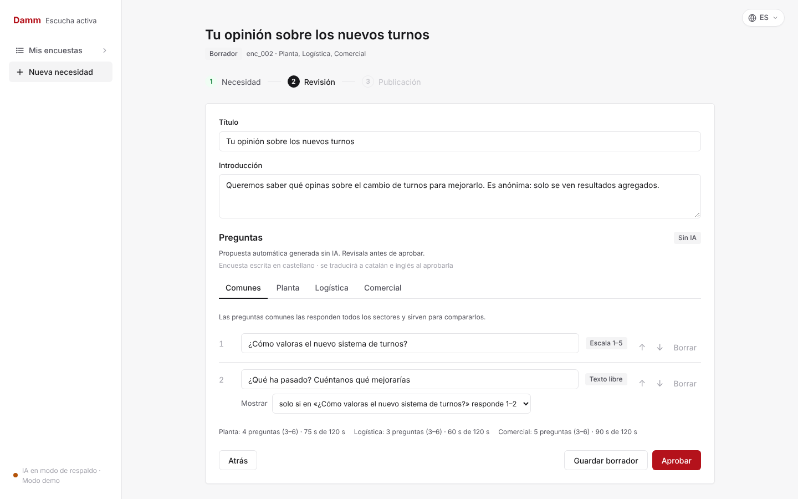
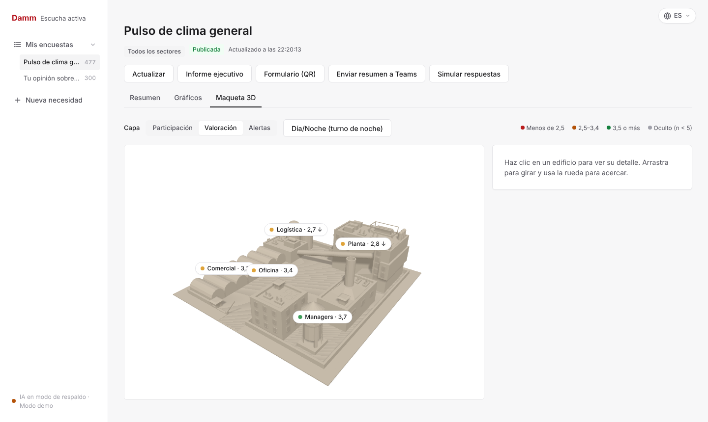
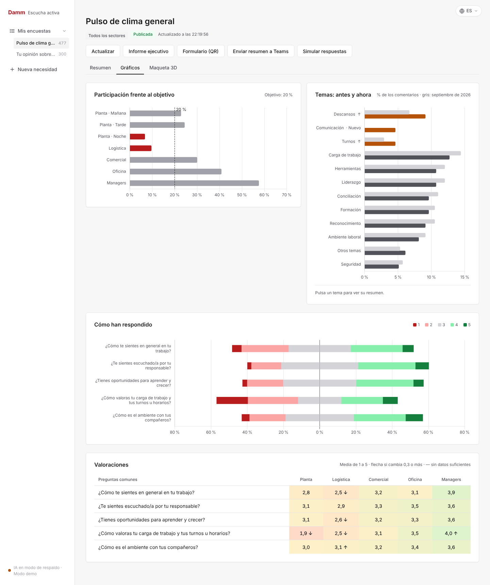
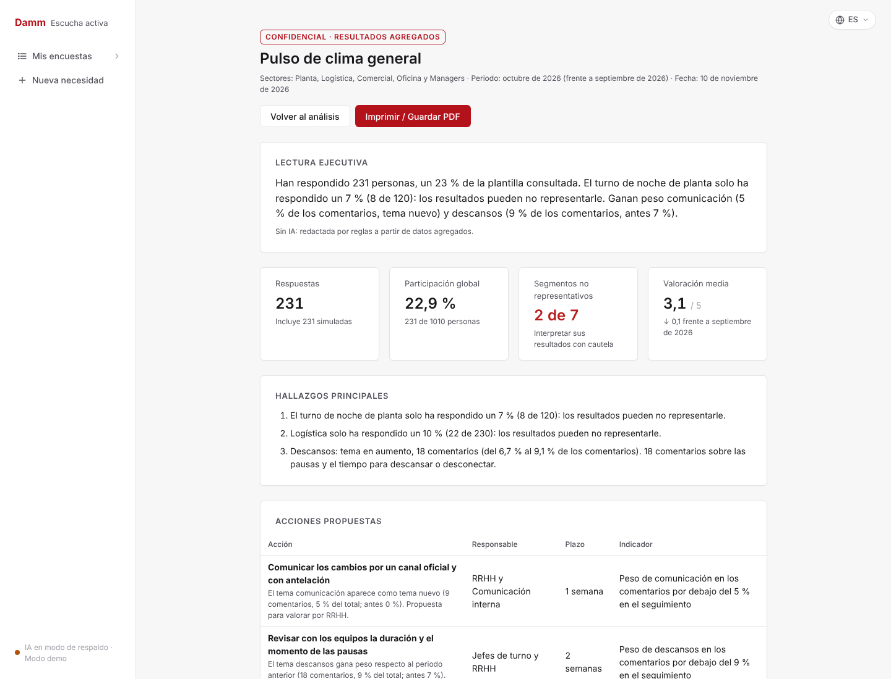
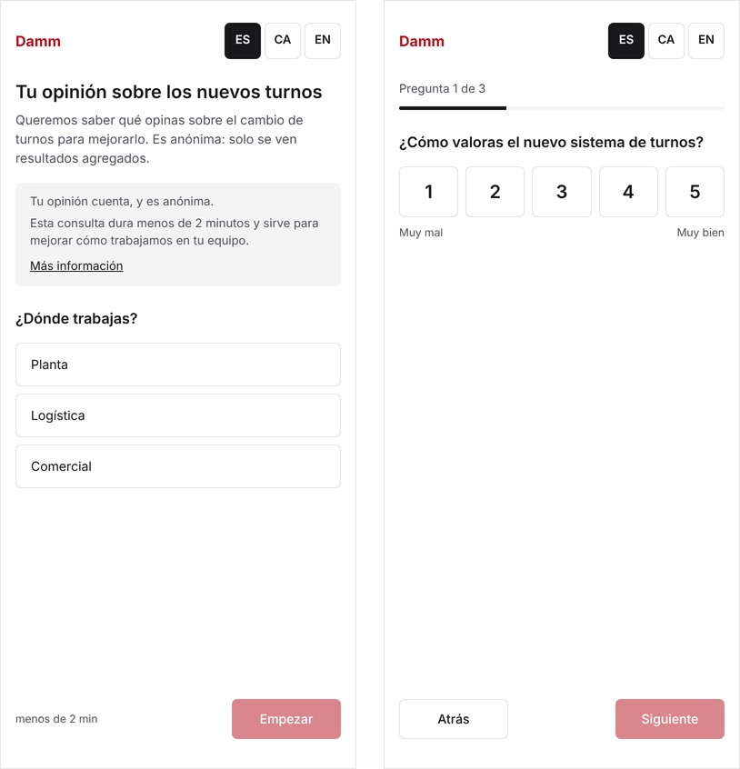
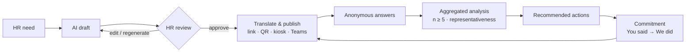

# RessoDAMM — AI-assisted employee listening

[](https://github.com/CarlosMontesMartin/caspersky/actions/workflows/ci.yml)


[](LICENSE)

**HR teams ask too much, hear too little, and rarely show what changed.** RessoDAMM is a full-stack platform that turns an HR need into a short, sector-specific survey, collects answers from shop-floor staff without a corporate account, and turns the results into actions that are reported back to the workforce: *"You said → We did"*.

Built in 24 hours at **UAB The Hack 2026** for the Damm challenge, then polished into a reference implementation. Español: [README.es.md](README.es.md).



> All data in this repository is **synthetic**. This is a student project and is not an official Damm product.

## Highlights

- **Human-in-the-loop AI.** An LLM drafts the survey, suggests actions and writes follow-up messages; nothing reaches employees until HR edits and approves it.
- **One survey, many audiences.** A shared core of questions keeps sectors comparable, while each sector (production, logistics, sales, office, managers) gets its own questions in its own vocabulary.
- **Works without AI.** Every model-powered feature has a deterministic fallback, and the UI labels each text by origin (AI, rules, pending). Comment classification reaches **99% accuracy** (402/406) on the synthetic dataset without any model.
- **Privacy by design.** k-anonymity threshold (n ≥ 5) with complementary suppression, so hidden groups cannot be recovered by subtraction; PII scrubbing in three languages; no IP, device or timestamp stored.
- **Statistically honest.** Participation is compared against the real workforce mix, under-represented groups are flagged, and the global score is also reported re-weighted by headcount (post-stratification).
- **Reaches the shop floor.** Mobile form in Spanish, Catalan and English, per-sector QR codes, printable posters, shared-tablet kiosk mode and Microsoft Teams Adaptive Cards.
- **Closes the loop.** Actions become signed commitments with an owner, deadline and indicator, are shown back to employees, and are measured with a follow-up survey.

## Screenshots

| Survey builder: shared core + per-sector questions | 3D plant view with data layers |
|---|---|
|  |  |
| **Charts by sector and shift** | **Executive report (print / PDF)** |
|  |  |

<p align="center"><br><em>Employee form on a phone: language, shift, then three to six questions.</em></p>

## How it works



Architecture, data flow and module responsibilities are documented in [docs/arquitectura.md](docs/arquitectura.md).

## Tech stack

| Layer | Technology |
|---|---|
| Backend | Python 3.10+, FastAPI, Uvicorn |
| AI | Any OpenAI-compatible chat API through a dependency-free client (`urllib`), with disk cache and background jobs |
| Storage | JSON documents behind a single storage module (swappable for a database) |
| Frontend | HTML, CSS and ES modules with no build step; Three.js (3D plant), Chart.js; i18n in es / ca / en |
| Integrations | Microsoft Teams via Power Automate webhooks (Adaptive Cards 1.4), QR codes |
| Quality | pytest, an end-to-end API scenario (240+ checks), i18n consistency check, GitHub Actions |

## Quick start

Requires **Python 3.10+**. The backend also serves the frontend, so there is nothing else to install.

```bash
git clone https://github.com/CarlosMontesMartin/caspersky.git
cd caspersky
cp .env.example .env     # optional: add an LLM key, Teams webhook, etc.
./run.sh                 # Windows: run.bat · any OS: python run.py
```

Open **http://localhost:8000**. `run.py` creates a virtual environment, installs dependencies and loads the synthetic data. API docs are generated at `/docs`.

To enable the AI, set `LLM_API_KEY`, `LLM_BASE_URL` and `LLM_MODEL` in `.env` for any OpenAI-compatible provider. All options are listed in [docs/configuracion.md](docs/configuracion.md).

## Testing

```bash
python -m pytest                       # storage, metrics, anonymisation
python -m backend.api.probar_ciclo     # end-to-end: generate → approve → publish → answer → analyse → commit
python -m backend.ia.probar_generar    # generation robustness and rule validation
python -m backend.ia.probar_analizar   # comment classification accuracy (es / ca / en)
python scripts/comprobar_i18n.py       # every UI string exists in all three languages
```

All suites run in CI on every push without an API key, which guarantees the non-AI fallback never regresses.

## Project structure

```
├── backend/
│   ├── api/            FastAPI app: routes, validation, translations, Teams, QR, simulation
│   ├── datos/          JSON storage, metrics, k-anonymity, PII scrubbing + tests
│   ├── ia/             LLM client, generation, analysis, recommendations, prompts
│   ├── reglas.py       survey constraints and languages (single source of truth)
│   └── textos.py       server-side strings in es / ca / en
├── frontend/           HR screens, employee form, i18n, vendored Three.js and Chart.js
├── datos_sinteticos/   synthetic data generator with two survey periods
├── contenido/          per-sector guidelines, workforce template, transparency notice
├── docs/               architecture, API, configuration, decisions, privacy, examples
├── scripts/            maintenance checks
└── run.py              one-command launcher (run.sh / run.bat)
```

## Documentation

| Document | Contents |
|---|---|
| [Architecture](docs/arquitectura.md) | Components, data flow, tests |
| [API](docs/api.md) | Endpoints and JSON examples |
| [Configuration](docs/configuracion.md) | Environment variables, mobile access, troubleshooting |
| [Technical decisions](docs/decisiones.md) | Why, and at what cost |
| [Privacy](docs/privacidad.md) | Anonymity guarantees and limits |
| [UI design](docs/diseno.md) | Design tokens and screen structure |

*Documentation is in Spanish, the working language of the challenge.*

## Team

Built by a four-person team combining computer engineering and business & technology:

| Name | Background | Focus |
|---|---|---|
| [Carlos Montes Martín](https://www.linkedin.com/in/carlos-montes-martín-54aa35380) | Computer Engineering, UPC |AI pipeline: LLM client, survey generation, hybrid comment classification, fallback rules|
| [Norman Castro Vega](https://www.linkedin.com/in/norman-castro-8352ba373/) | Computer Engineering, UPC |Backend API, Microsoft Teams and QR integrations, mobile access, end-to-end tests|
| [Aroa Busto Martín](https://www.linkedin.com/in/aroabustomartin) | Business & Technology, UAB |Frontend & UX: HR screens, dashboard, 3D plant view, multilingual interface|
| [Eric Montes Martín](https://www.linkedin.com/in/eric-montes-martin/) | Business & Technology, UAB | Synthetic data, per-sector survey guidelines, privacy and analytics design |

## License

[MIT](LICENSE). Third-party libraries in `frontend/vendor/` keep their own licenses.
