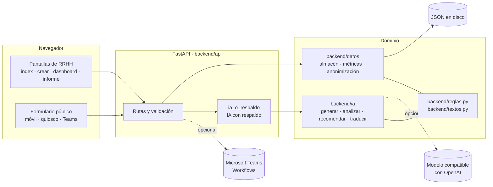
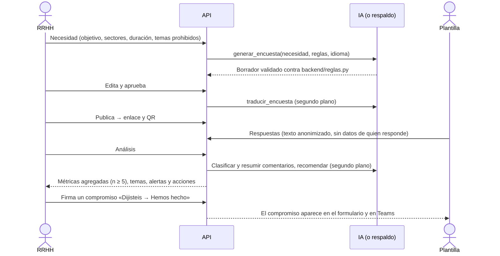

# Arquitectura

La aplicación es un único servicio Python (FastAPI) que expone la API y sirve un frontend estático sin paso de compilación. Todo el estado vive en ficheros JSON y la IA es opcional: cada función que usa un modelo tiene un respaldo determinista.

## Capas

| Capa | Carpeta | Responsabilidad |
|---|---|---|
| Presentación | `frontend/` | HTML, CSS y JavaScript (módulos ES) servidos tal cual. Toda llamada a la API pasa por `js/api.js`. Textos en `i18n/` (es, ca, en). Three.js y Chart.js van en `vendor/` para funcionar sin internet. |
| API | `backend/api/` | Rutas, validación de entrada, traducciones, Teams, QR y simulación. Convierte los errores de dominio en 404, 409 o 422 con mensajes legibles. |
| Datos | `backend/datos/` | Único módulo que lee y escribe disco (`almacen.py`). Métricas agregadas, umbral de anonimato, anonimización de comentarios y compromisos. Sin dependencias de FastAPI. |
| IA | `backend/ia/` | Generación de encuestas, clasificación y resumen de comentarios, recomendaciones, traducción y preguntas en lenguaje natural. Cliente HTTP propio con la librería estándar. |
| Reglas | `backend/reglas.py`, `backend/textos.py` | Límites de las encuestas e idiomas en un solo sitio, y frases del backend en tres idiomas. Los importan la validación y la IA. |
| Contenido | `contenido/` | Plantilla de personas por colectivo, reglas de redacción por colectivo, textos de transparencia y escenarios. Se edita sin tocar código. |

## Flujo de una encuesta

## Decisiones de diseño

Las razones detrás de cada decisión están en [`decisiones.md`](decisiones.md). En resumen:

- **IA siempre con respaldo.** Si no hay clave, el modelo tarda o devuelve un JSON inválido, se usan reglas. La interfaz indica el origen de cada texto (`ia`, `pendiente` o `reglas`).
- **Lo lento, en segundo plano.** El análisis responde en menos de un segundo con reglas. La clasificación, los resúmenes y las recomendaciones del modelo se calculan en hilos aparte y se guardan en una caché en disco (claves sha256, sin comentarios en claro).
- **Validación antes que confianza.** Toda salida del modelo pasa por la misma validación que una encuesta escrita a mano. Una prueba de robustez lanza 400 salidas malformadas y exige que todas acaben en una encuesta válida.
- **Contrato estable.** Entre módulos solo viajan diccionarios con los formatos de [`ejemplos/`](ejemplos/). El frontend puede trabajar contra esos ejemplos sin backend.

## Pruebas

| Comando | Cobertura |
|---|---|
| `python -m pytest` | Almacén, métricas (incluida la supresión complementaria), anonimización y compromisos. |
| `python -m backend.api.probar_ciclo` | Recorre el ciclo completo por la API con datos temporales: más de 240 comprobaciones. No necesita el servidor arrancado. |
| `python -m backend.ia.probar_generar` | Robustez de la generación frente a salidas malformadas del modelo e idiomas del respaldo. |
| `python -m backend.ia.probar_analizar` | Clasificación de comentarios sin IA en castellano, catalán e inglés. |
| `python scripts/comprobar_i18n.py` | Las tres traducciones del frontend tienen las mismas claves y no falta ninguna usada en el código. |

Todas se ejecutan en GitHub Actions en cada push ([`.github/workflows/ci.yml`](../.github/workflows/ci.yml)).
